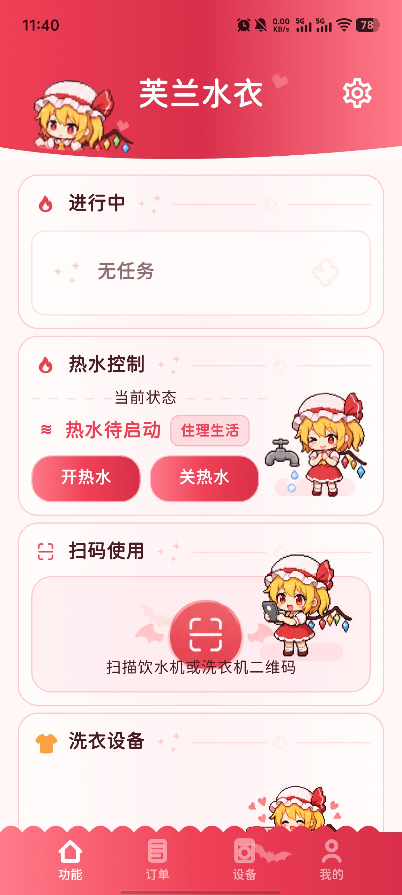
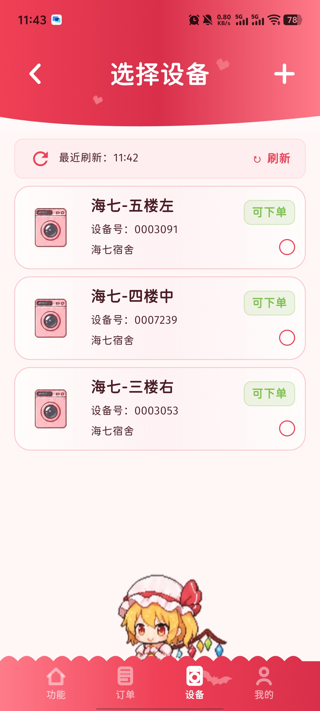
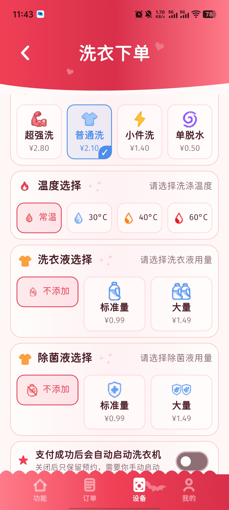

  

# 芙兰水衣 FlandreSY

芙兰水衣是一款面向校园与公寓生活场景的应用，将洗衣、饮水、住理热水与慧生活 798 的常用操作集中在一起。

当前版本：**2.2.1**。本次更新修复洗衣付款后卡住的问题，新增洗衣提醒与消费统计。

## 项目截图

  
  
  

## 主要功能

- **洗衣**：选择或扫码添加设备，查看洗衣程序，创建订单、支付后自动启动，结束前提醒，并查看订单状态和历史。
- **饮水**：扫码进入设备、创建接水订单，刷新状态并保留历史记录。
- **住理热水**：管理账号与设备，手动开启、关闭热水，查看会话状态和历史。
- **慧生活 798**：登录账号、选择设备，手动进行洗浴控制并恢复本地会话。
- **账号与设备管理**：本地登出、账号检测、设备重命名，以及设备列表导入和导出。
- **消费统计**：查看本月及近 6 个月洗衣、饮水、热水的消费。
- **使用辅助**：检查更新、查看诊断日志、按需申请权限。

## 2.2.1 更新

### 洗衣

- 修复付款后停留在支付页、订单一直显示“待刷新”且无法操作的问题；停留在支付宝或熄屏时也会继续确认到账，并自动启动洗衣机。
- 订单状态异常时可以刷新或移除本机记录，不会再卡住；多个 U净 账号的订单分开保存。
- 新增洗衣结束前约 5 分钟和预计结束时的提醒，以及洗衣中的常驻倒计时通知。倒计时按实际用时多算 5 分钟。

### 首页与订单

- 首页“进行中”的任务可以点击进入详情，洗衣剩余时间实时更新。
- 订单列表显示下单时间，热水记录去掉重复的设备信息。
- 新增消费统计：订单页显示本月消费，可查看分项金额和近 6 个月走势。

完整更新内容见 [2.2.1 更新说明](docs/releases/2.2.1.md)。

## 下载与升级

[下载 2.2.1 通用 APK](https://github.com/amamiyakazuki/FlandreSY/releases/download/v2.2.1/app-release.apk) · [查看 Release](https://github.com/amamiyakazuki/FlandreSY/releases/tag/v2.2.1)

本版统一提供适用于 ARM64 与 x86_64 的通用安装包，不提供 32 位 ARM 或 iOS 安装包。已有用户请保留原应用进行覆盖安装，不要先卸载，以免丢失本地记录。洗衣提醒需要允许通知权限。

## 使用说明

- 应用连接真实服务，付款与设备操作会产生实际效果。
- 页面显示的热水恢复状态不代表实体设备已经自动关水；请结合现场情况核对。
- iOS 住理蓝牙热水控制暂不可用；目前没有 iOS 安装包下载渠道。
- 本项目不是服务提供方的官方客户端。

## 历史更新

- [2.2.0](docs/releases/2.2.0.md)：设备状态与进行中卡片布局、设备刷新冲突修复、热水历史账号隔离、移除模拟模式。
- [2.1.4](docs/releases/2.1.4.md)：旧订单归属恢复、账号检测与登出、首页卡片及热水详情优化。
- [2.1.3](docs/releases/2.1.3.md)：热水重复启动防护、会话恢复与账号切换隔离。

## 项目资料

[开发与维护说明](docs/development.md) · [安全说明](SECURITY.md) · [AGPL-3.0 许可](LICENSE)
