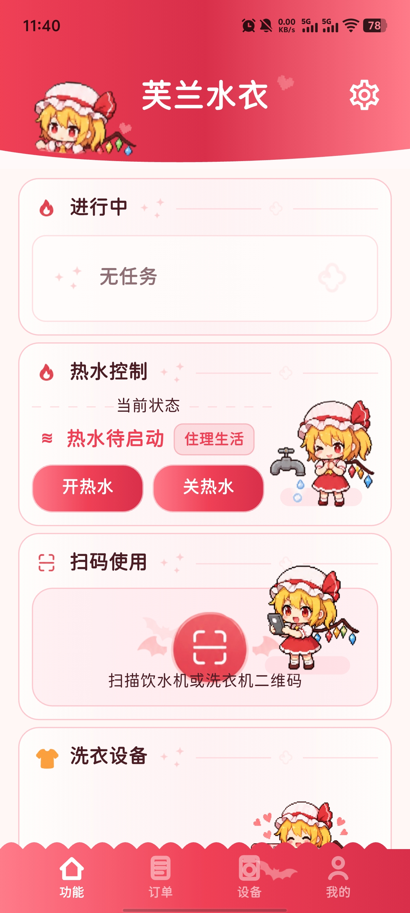
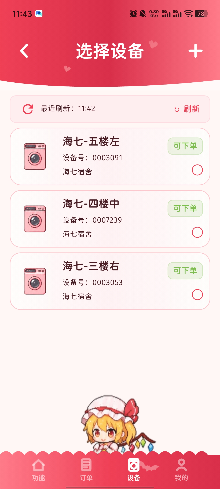
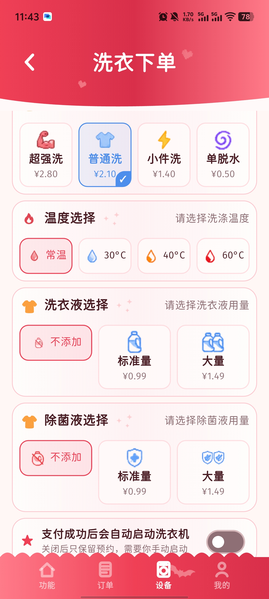

  

# 芙兰水衣 FlandreSY

芙兰水衣是一款面向校园与公寓生活场景的应用，将洗衣、饮水、住理热水与慧生活 798 的常用操作集中在一起。

当前版本：**2.2.0**。本次更新集中改善设备与订单反馈、旧数据保留及页面显示。

## 项目截图

  
  
  

## 主要功能

- **洗衣**：选择或扫码添加设备，查看洗衣程序，创建订单、支付，并查看订单状态和历史。
- **饮水**：扫码进入设备、创建接水订单，刷新状态并保留历史记录。
- **住理热水**：管理账号与设备，手动开启、关闭热水，查看会话状态和历史。
- **慧生活 798**：登录账号、选择设备，手动进行洗浴控制并恢复本地会话。
- **账号与设备管理**：本地登出、账号检测、设备重命名，以及设备列表导入和导出。
- **使用辅助**：检查更新、查看诊断日志、按需申请权限，并查看旧数据保全进度。

## 2.2.0 更新

### 页面与操作体验

- 设备运行提示改用“运行中”等短文字，避免挤掉设备名称和编号；点击状态可查看完整说明。
- 热水状态标题与提示保持紧凑，较长异常可点开查看，减少文字切换造成的页面跳动。
- 首页洗衣、热水和饮水的进行中卡片更扁平，任务出现时不再撑开原有区域。

### 设备与订单

- 修复设备刷新与重命名、排序等操作相互覆盖的问题，导入错误和刷新结果有更明确的提示。
- 改善洗衣订单跨页面、切回应用后的状态同步，减少页面状态与可用操作不一致的情况。
- 热水历史按账号区分，加载失败与暂无记录分别显示，并提供重试入口。
- 798 设备未查询时不再显示为待机，登录、列表加载与保存失败的提示更准确。

### 旧数据与使用反馈

- 移除模拟模式，保留旧设备、设置和业务记录；各服务首次使用需重新登录。
- 来源不明的旧活动保留待核对，核对前不据此控制设备，可在“更多选项 → 旧数据保全”查看进度。
- 改善网络超时、更新检查与权限提示，避免将未确认结果显示为成功。
- 修复诊断日志清空后旧内容重新出现的问题，并减少诊断内容中的敏感信息。

完整更新内容见 [2.2.0 更新说明](docs/releases/2.2.0.md)。

## 下载与升级

[下载 2.2.0 通用 APK](https://github.com/amamiyakazuki/FlandreSY/releases/download/v2.2.0/app-release.apk) · [查看 Release](https://github.com/amamiyakazuki/FlandreSY/releases/tag/v2.2.0)

本版统一提供适用于 ARM64 与 x86_64 的通用安装包，不提供 32 位 ARM 或 iOS 安装包。已有用户请保留原应用进行覆盖安装，不要先卸载，以免丢失本地记录。各服务首次使用需重新登录，旧活动可在“更多选项 → 旧数据保全”中查看核对进度。

## 使用说明

- 应用连接真实服务，付款与设备操作会产生实际效果。
- 页面显示的热水恢复状态不代表实体设备已经自动关水；请结合现场情况核对。
- iOS 住理蓝牙热水控制暂不可用；目前没有 iOS 安装包下载渠道。
- 本项目不是服务提供方的官方客户端。

## 历史更新

- [2.1.4](docs/releases/2.1.4.md)：旧订单归属恢复、账号检测与登出、首页卡片及热水详情优化。
- [2.1.3](docs/releases/2.1.3.md)：热水重复启动防护、会话恢复与账号切换隔离。

## 项目资料

[开发与维护说明](docs/development.md) · [安全说明](SECURITY.md) · [AGPL-3.0 许可](LICENSE)
